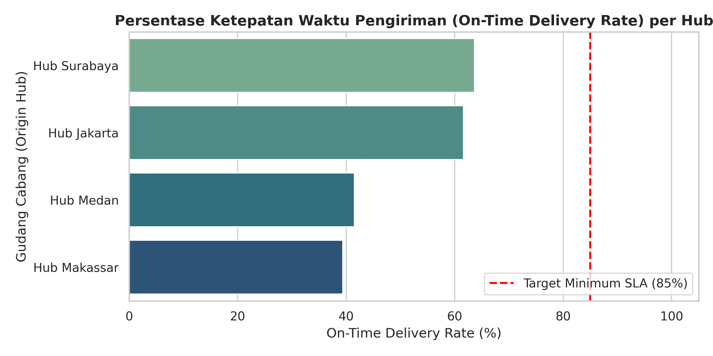
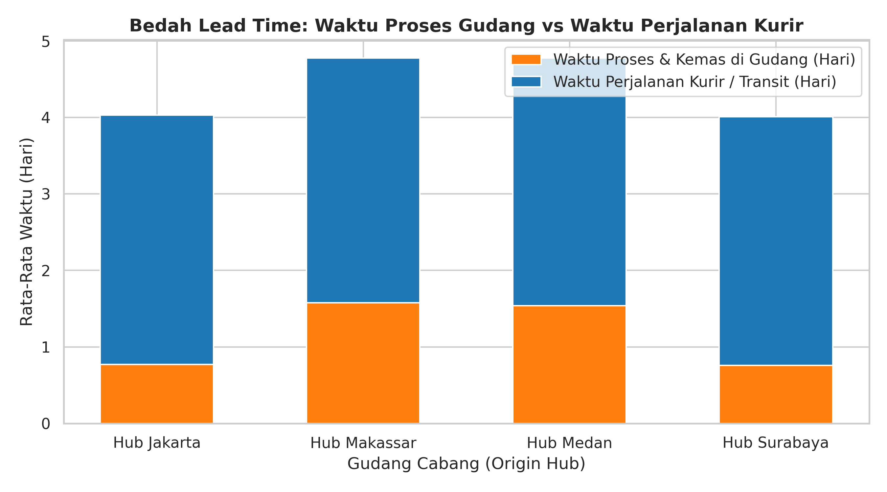
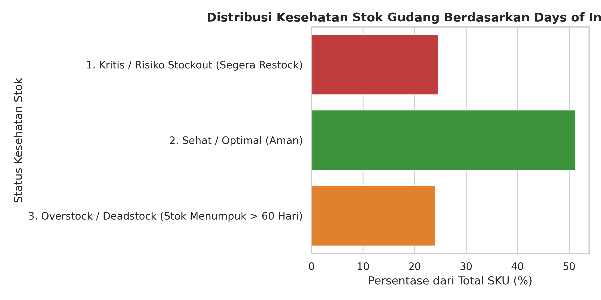

# 🚚 Analisis Efisiensi Pengiriman & Manajemen Stok Gudang (*Supply Chain Analytics*)

## 📌 Latar Belakang Bisnis (Business Problem)
Ketepatan waktu pengiriman (*On-Time Delivery*) dan ketersediaan stok barang di gudang adalah kunci utama kepuasan pelanggan serta efisiensi biaya operasional. Keterlambatan pengiriman sering kali langsung disalahkan pada pihak kurir ekspedisi, padahal kemacetan (*bottleneck*) juga bisa terjadi pada proses pengemasan internal di gudang cabang. Selain itu, pengelolaan stok yang tidak seimbang memicu risiko kehabisan barang laris (*stockout*) atau penumpukan modal pada barang lambat laku (*overstock*).

Proyek ini bertujuan untuk:
1. Mengevaluasi pencapaian **SLA (Service Level Agreement) / On-Time Delivery Rate** di empat gudang cabang (*Fulfillment Hub*).
2. Mengidentifikasi akar penyebab keterlambatan dengan membedah **waktu proses internal gudang vs waktu tempuh kurir**.
3. Memetakan kesehatan stok 150 SKU menggunakan metrik **Days of Inventory (DOI)** dibandingkan dengan waktu tunggu pemasok (*Supplier Lead Time*).

---

## 🛠️ Tools & Metodologi
* **Environment:** Google Colab (Python 3)
* **Libraries:** `pandas`, `numpy`, `matplotlib`, `seaborn`
* **Metrik Operasional Utama:**
  * **On-Time Delivery (OTD) Rate:** Persentase pesanan tiba $\le$ target hari SLA.
  * **Total Order Lead Time:** `Warehouse Prep Time` + `Courier Transit Time`.
  * **Days of Inventory (DOI):** `Current Stock Units` $\div$ `Average Daily Sales`.

---

## 📊 Hasil Analisis & Temuan Utama

### 1. Evaluasi Pencapaian SLA Pengiriman per Gudang Cabang

* **Hub Jakarta** dan **Hub Surabaya** berhasil melampaui standar target minimum SLA perusahaan (di atas 85% pengiriman tepat waktu).
* Sebaliknya, **Hub Medan** dan **Hub Makassar** memiliki tingkat keterlambatan yang cukup tinggi sehingga berada di bawah batas target SLA.

### 2. Bedah Akar Masalah Keterlambatan (Bottleneck Analysis)

* Hasil pemisahan komponen *lead time* membuktikan bahwa waktu perjalanan kurir (*Transit Days*) di semua wilayah relatif seragam (rata-rata ~3,3 hari).
* Penyebab utama keterlambatan di **Hub Medan dan Makassar** adalah **lamanya waktu persiapan dan pengemasan barang di dalam gudang (*Warehouse Prep Time*)** yang mencapai 1,6 hingga 1,7 hari (dua kali lipat lebih lambat dibandingkan Hub Jakarta/Surabaya yang hanya ~0,75 hari).

### 3. Analisis Kesehatan Stok Gudang (Inventory Health)

* Ditemukan sekelompok SKU berstatus **Kritis (Risiko Stockout)** karena sisa ketahanan stoknya (*Days of Inventory*) sudah lebih pendek daripada waktu tunggu pengiriman barang baru dari pemasok (*Supplier Lead Time*).
* Di sisi lain, terdapat sejumlah SKU yang mengalami **Overstock (stok bertahan > 60 hari)** yang mengikat modal kerja dan ruang penyimpanan gudang.

---

## 💡 Rekomendasi Operasional (Actionable Insights)

1. **Optimalisasi Proses *Picking & Packing* di Hub Medan dan Makassar:**
   Masalah keterlambatan bukan terletak pada kurir ekspedisi, melainkan pada antrean pengemasan internal. Manajemen perlu menata ulang tata letak rak gudang (*slotting optimization*) dan menambah *shift* staf pengemasan pada jam sibuk di kedua hub tersebut untuk memangkas waktu proses menjadi $\le 1$ hari.
2. **Penerapan *Automated Reorder Point (ROP)* untuk SKU Kritis:**
   Segera lakukan pemesanan ulang (*restock*) untuk SKU berstatus kritis dan aktifkan peringatan otomatis di sistem gudang ketika *Days of Inventory* menyentuh batas `Supplier Lead Time + 3 hari Safety Stock`.
3. **Likuidasi Stok Menumpuk (*Overstock Clearance*):**
   Hentikan pemesanan ulang sementara untuk SKU berstatus *Overstock* (> 60 hari) dan koordinasikan dengan tim pemasaran untuk membuat promo *flash sale* atau paket *bundling* guna mencairkan modal yang tertahan di gudang.

---

## 📂 Struktur File di Repository Ini
* `Supply_Chain_and_Delivery_Analysis.ipynb` — Notebook analisis lengkap dari pengolahan metrik SLA, *lead time*, hingga kesehatan inventori.
* `*.png` — Visualisasi grafik temuan operasional.
